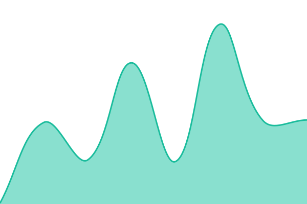
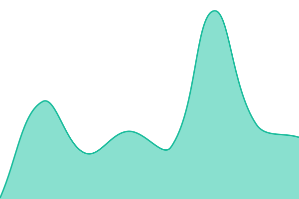
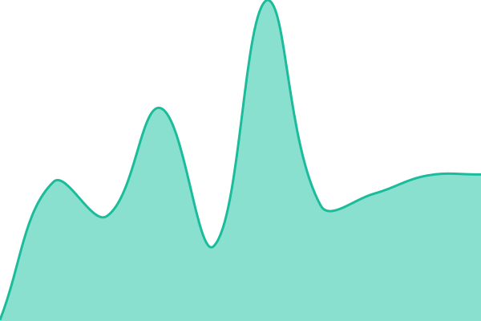

# status

Driftsstatus for [hpgt.com](https://hpgt.com) og [flysteder.hpgt.com](https://flysteder.hpgt.com), på
**[status.hpgt.com](https://status.hpgt.com)**. Laget med [Upptime](https://upptime.js.org): GitHub Actions sjekker
adressene hvert 5. minutt, lagrer resultatene her og lager en sak når noe går ned (lukkes når det er oppe igjen).
Sjekken kjører hos GitHub, ikke hos Cloudflare der sidene ligger, så den virker også når Cloudflare er nede.

<!--start: status pages-->
<!-- This summary is generated by Upptime (https://github.com/upptime/upptime) -->
<!-- Do not edit this manually, your changes will be overwritten -->
<!-- prettier-ignore -->
| URL | Status | History | Response Time | Uptime |
| --- | ------ | ------- | ------------- | ------ |
|  [hpgt.com](https://hpgt.com/) | 🟩 Up | [hpgt-com.yml](https://github.com/hpgt-com/status/commits/HEAD/history/hpgt-com.yml) | 

 100ms
     
 | 

<a href="https://status.hpgt.com/history/hpgt-com">100.00%</a>
    

|  [Skjemaene på hpgt.com](https://hpgt.com/api/radioid) | 🟩 Up | [skjemaer.yml](https://github.com/hpgt-com/status/commits/HEAD/history/skjemaer.yml) | 

 98ms
     
 | 

<a href="https://status.hpgt.com/history/skjemaer">100.00%</a>
    

|  [flysteder.hpgt.com](https://flysteder.hpgt.com/) | 🟩 Up | [flysteder.yml](https://github.com/hpgt-com/status/commits/HEAD/history/flysteder.yml) | 

 130ms
     
 | 

<a href="https://status.hpgt.com/history/flysteder">100.00%</a>
    

|  [Datatjenesten for flysteder](https://data.hpgt.com/v1/status.json) | 🟩 Up | [datatjenesten.yml](https://github.com/hpgt-com/status/commits/HEAD/history/datatjenesten.yml) | 

 205ms
     
 | 

<a href="https://status.hpgt.com/history/datatjenesten">100.00%</a>
    

<!--end: status pages-->

## Hva som sjekkes

Står i [`.upptimerc.yml`](.upptimerc.yml): hpgt.com, skjemaene på hpgt.com (workeren svarer 405 på GET),
flysteder.hpgt.com og datatjenesten (`data.hpgt.com/v1/status.json` må svare og melde `"ok":true`). En ny adresse legges
til der, med en pull request.

## Workflowene

Upptimes mal er **ikke** brukt direkte. Workflowene i `.github/workflows/` er skrevet om:

- **Ingen personlig token.** GitHub-appen «HPGT Status» (bare installert på dette repoet, bare Contents og Issues) gir et
  token som varer én time, og hver jobb ber bare om `contents: write` og `issues: write`. App-ID og nøkkel ligger i
  miljøet `status` (bare `main`): variabelen `STATUS_APP_ID` og secreten `STATUS_APP_PRIVATE_KEY`.
- **Låste versjoner** av alle actions (commit-SHA), oppdatert av Dependabot.
- **Upptimes «update-template» og «updates» er tatt ut.** De henter workflows fra Upptime (`@master`) og overskriver alt
  under `.github/`, også sikkerhetssjekkene fra `repo-template`. Nye Upptime-versjoner tas inn med en pull request.

| Workflow            | Når                             | Hva                                                          |
| ------------------- | ------------------------------- | ------------------------------------------------------------ |
| `uptime.yml`        | hvert 5. minutt                 | Sjekker adressene, lager og lukker saker                     |
| `response-time.yml` | daglig                          | Svartidene                                                   |
| `graphs.yml`        | daglig                          | Grafene                                                      |
| `summary.yml`       | daglig                          | Oversikten øverst i denne README-en                          |
| `site.yml`          | daglig, og når `assets/` endres | Bygger statussiden og publiserer den til branchen `gh-pages` |
| `setup.yml`         | når `.upptimerc.yml` endres     | Alt over på nytt                                             |

Upptime committer rett til `main` med appens token, så appen må stå i unntakslisten (bypass) i regelsettet for `main`.

## Oppsett (gjort én gang)

- GitHub Pages: Settings → Pages → _Deploy from a branch_ → `gh-pages` / `(root)`, egendefinert domene
  `status.hpgt.com`, _Enforce HTTPS_.
- Cloudflare DNS: `status` CNAME `hpgt-com.github.io` (DNS only, grå sky). Domenet er bekreftet for GitHub Pages i org-en.

## Sikkerhet

Se [SECURITY.md](SECURITY.md).
